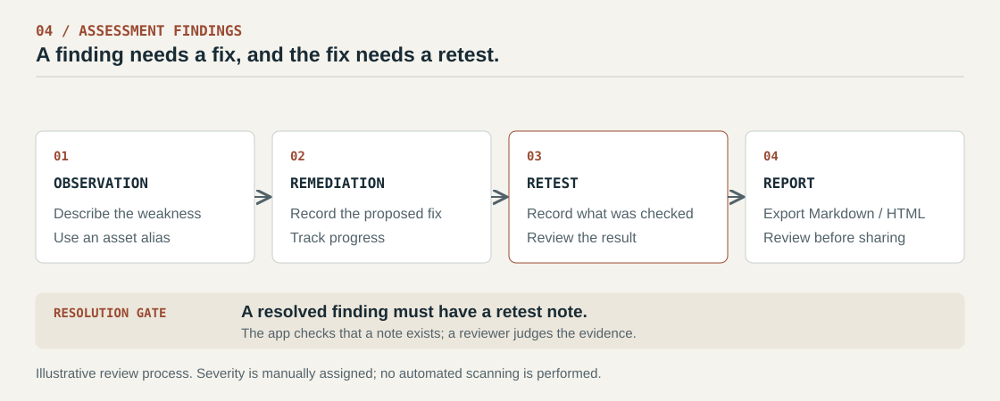
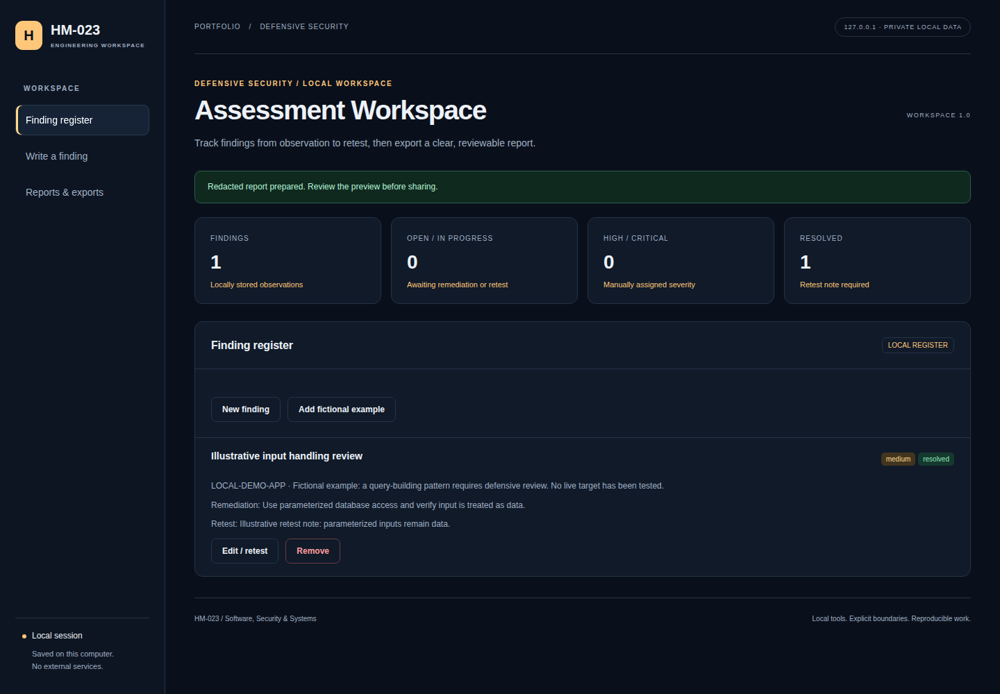

# Authorized Security Assessment Lab

A security assessment is useful when an observation leads to a clear fix and a meaningful retest. This repository contains a sanitized lab-methodology case study and a later local app for tracking that process.

**Assessment methodology · Remediation · Python reporting**

[Scope and method](docs/scope-and-method.md) · [Finding categories](docs/findings.md) · [Finding template](templates/finding-template.md) · [Remediation checklist](docs/remediation-checklist.md)



## The assessment work

The case study covers input handling, browser security policy and unnecessary service exposure in local training environments. Its public [finding summaries](docs/findings.md) connect each weakness category to a fix and a retest approach.

For example, a SQL injection finding should explain the unsafe query construction, recommend parameterized queries, and verify that untrusted input stays data after the fix. A category name alone is not sufficient evidence of a vulnerability.

Original reports, target identifiers and screenshots are excluded. The public categories summarize historical exercises; they are not newly verified findings against a live target. [Background and scope](docs/reference-case-study.md)

## Later extension: findings register

The Python app keeps findings in SQLite and exports Markdown or escaped HTML reports. Each record contains an asset alias, observation, manually assigned severity, remediation, optional evidence and retest notes.

Its main workflow rule is small and deliberate: **a finding cannot be marked resolved without a retest note**. The app enforces the presence of that note; a reviewer must still judge whether the retest is adequate.

| State | Meaning |
|---|---|
| Open | Observation needs review or action |
| In progress | Remediation is being tracked |
| Resolved | A retest note has been recorded |
| Accepted | Risk acceptance has been recorded |

## Try it with fictional data

Requires Python 3.11+; no third-party Python packages.

```powershell
python -m webapp.app
```

Open [localhost:8104](http://127.0.0.1:8104) and select **Add fictional example**. Edit the finding, record a retest note, and prepare a report under **Reports & exports**.

```powershell
python -m unittest discover -s tests -v
```

Tests cover the resolution gate, persistence, invalid severity, HTML escaping and pattern redaction. [Application CI](https://github.com/HM-023/AuthorizedSecurityAssessmentLab/actions/workflows/workspace.yml)

<details>
<summary>Register screenshot and documentation</summary>



[App guide](docs/workspace-guide.md) · [Implementation](docs/workspace-architecture.md) · [Verification scope](docs/workspace-verification.md)

</details>

**Scope:** this app records assessment work; it does not scan or exploit targets, or calculate CVSS scores. Export redaction recognizes some email, IPv4 and credential patterns. It cannot reliably remove personal names or every sensitive value, so exported reports need manual review before sharing.

[Publication and contribution notes](PUBLICATION_NOTES.md)
