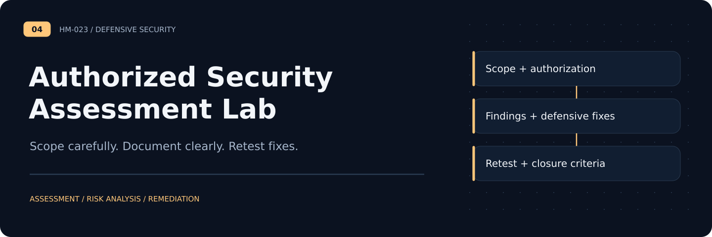
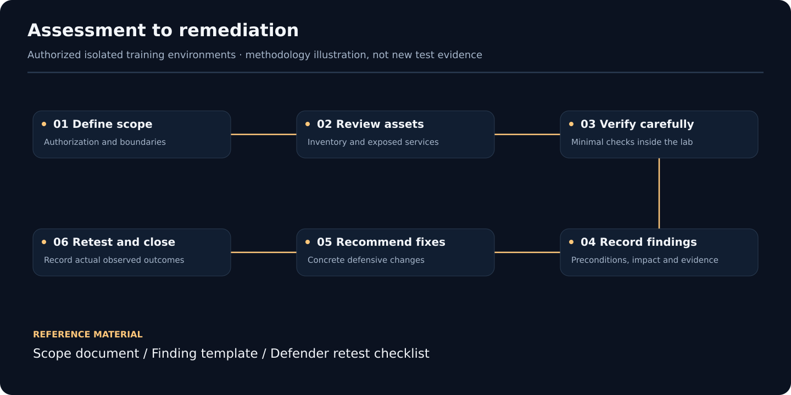

# Authorized Security Assessment Lab

**Methodology case study** · [Portfolio](https://github.com/HM-023) · [Scope and method](scope-and-method.md) · [Findings](findings.md) · [Finding template](../templates/finding-template.md)

A defensive write-up of vulnerability assessment methodology demonstrated in intentionally vulnerable **local training applications and virtual machines**. This repository focuses on scope, risk reasoning, and remediations. It is **not** an instruction set for testing real websites.

## Assessment workflow

## Included

- `docs/scope-and-method.md` — authorization, training scope and evidence handling
- `docs/findings.md` — non-sensitive descriptions of common training-app vulnerability classes and fixes
- `docs/remediation-checklist.md` — verification steps for the defender
- `templates/finding-template.md` — reusable, sanitized finding template

## Historical coverage

The underlying exercises included network/service enumeration and training demonstrations of web-application weakness categories such as SQL injection and cross-site scripting, plus attention to missing security headers and service exposure. The original logs/screenshots are **not redistributed** and these historical results were **not independently retested**.

## Safety and privacy

No real public websites, individual names, contact information, unredacted credentials, active session tokens, exploitation artifacts, or evasion/anti-forensic walkthroughs are provided. All sample identifiers in this repository are generic. Do not scan or test any target without express authorization.

## Project status

A sanitized **methodology and remediation case study**, not a current penetration-test report or certification. Some original work was collaborative; ownership and permissions must be established before adding any original evidence.
